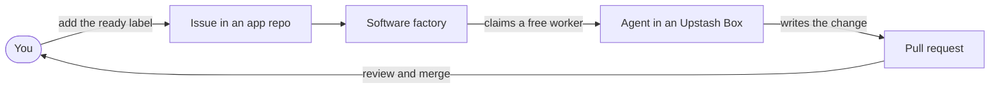
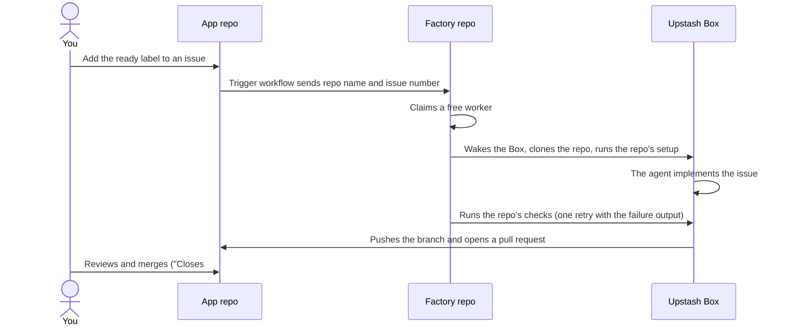

# Software Factory

Put a `ready` label on a GitHub issue. A coding agent picks it up inside an
Upstash Box, makes the change, and opens a pull request. You review it and
merge it yourself.



This factory runs **OpenCode CLI** agents (OpenCode Go subscription,
`deepseek-v4.1-flash`) in **Upstash Box** sandboxes, orchestrated by **GitHub
Actions**. Workers sign commits with their own AI persona names — Nova, Pixel,
Volt and Quill — on the owner's noreply address.



## Using it

1. Open an issue in `gerrcass/taskboard` (or any repo listed in
   [`factory.config.json`](factory.config.json)).
2. Add the `ready` label. Only `allowedActors` can start runs.
3. Watch the issue's labels: `factory:running` → `factory:review` (a PR is
   waiting) or `factory:needs-attention` (the factory explains why in a
   comment).
4. Review the pull request like any other; merging closes the issue.

**Read an issue before labelling it.** The agent reads the issue text, and
anyone who can edit an issue can put text in front of an agent that runs with
its approval prompts switched off.

## What lives where

| Path | What it is |
|---|---|
| `factory.config.json` | Repos, workers, agent types, model settings, allow-list. The file you edit. |
| `src/` | The coordination code: worker claiming, the Box session, git and GitHub. |
| `scripts/` | Everyday tools: `check-setup`, `status`, `release-worker`, `smoke-test`, `provision-workers`, `build-snapshot`, … |
| `worker/setup.sh` | The definition of the worker image (pinned OpenCode CLI; snapshotted into Upstash). |
| `.github/workflows/factory.yml` | The workflow one factory run executes. |
| `docs/guide.md` | **The developer guide**: architecture, secrets, models, costs, how to change the factory. |
| `docs/0*.md` | The build log of this factory, stage by stage. |

## Everyday commands

```bash
node --env-file=.env scripts/check-setup.mjs     # health check, read-only
node --env-file=.env scripts/status.mjs          # who is free, who is busy
node --env-file=.env scripts/release-worker.mjs <worker id>
node --env-file=.env scripts/apply-box-settings.mjs --yes
```

The guide's [Everyday commands](docs/guide.md#10-everyday-commands) section
lists all of them.
