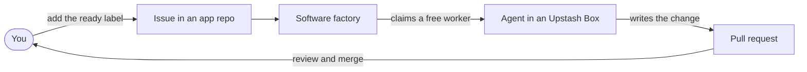
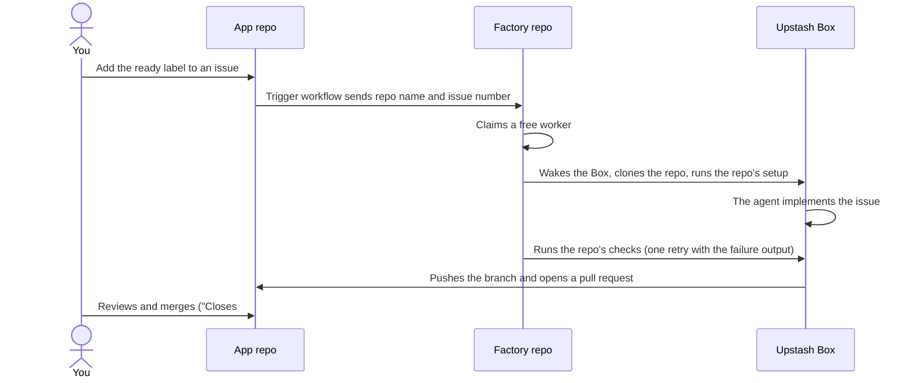
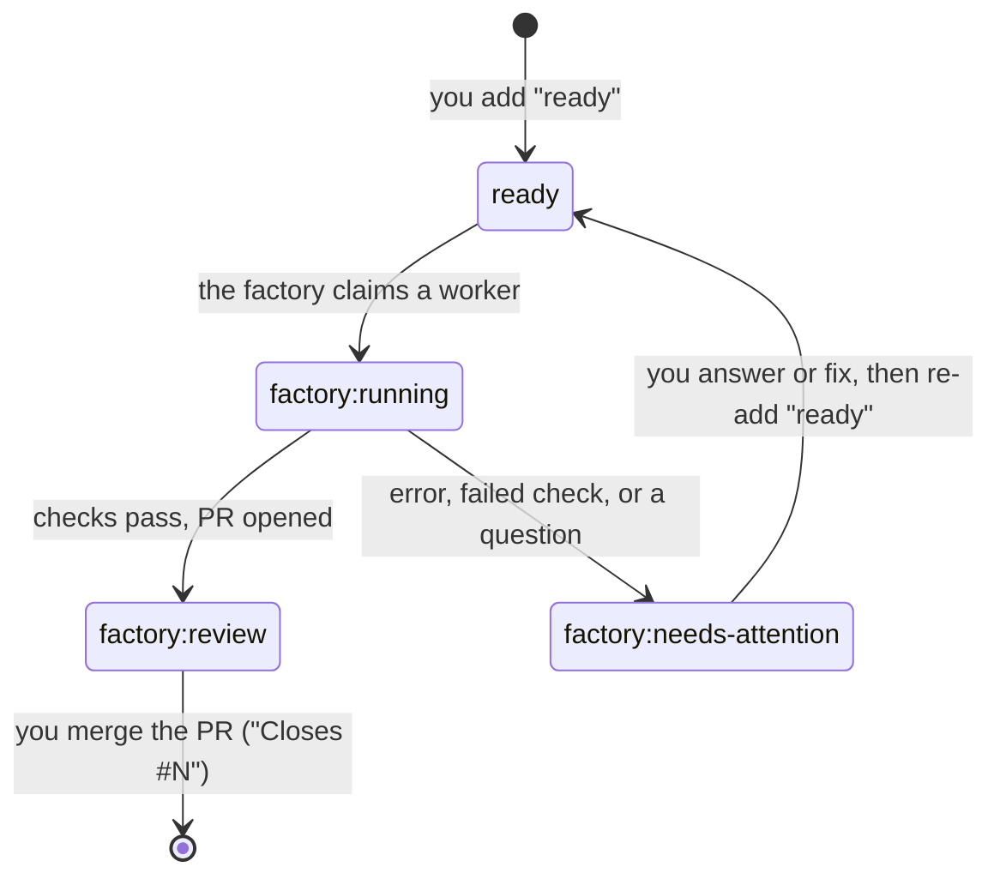
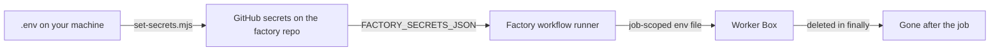
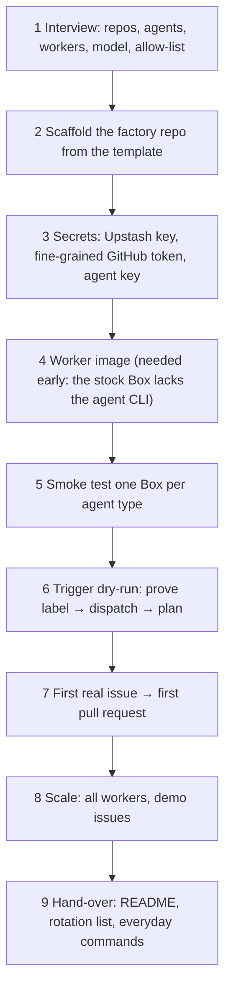

# The software factory — developer guide

Everything a developer needs to understand this factory: what it is, how an
issue becomes a pull request, where the secrets live, how to change it, and how
it was built.

If you only want to use it: put the `ready` label on an issue in
`gerrcass/taskboard` and wait for the pull request. The rest of this document
is for when you want to understand or change the machinery.

---

## 1. What this is

One sentence: **an issue with the `ready` label gets implemented by a coding
agent inside an Upstash Box, comes back as a pull request, and a human reviews
and merges it.**



The factory itself lives in this repository. App repositories (currently
`gerrcass/taskboard`) hold a small trigger workflow and nothing else. The
coding agents are OpenCode CLI sessions signed in with an OpenCode Go
subscription; the sandboxes are Upstash Boxes; the orchestration runs on
GitHub Actions.

---

## 2. The moving parts

| Part | Where it lives | What it does |
|---|---|---|
| Trigger workflow | `.github/workflows/factory-ready.yml` in each **app repo** | When someone on the allow-list adds the `ready` label, sends the repo name and issue number to the factory repo. |
| Factory workflow | `.github/workflows/factory.yml` in this repo | Receives the event and runs the coordination code on a GitHub-hosted runner. One run per issue at a time. |
| Coordination code | `src/` | Picks and claims a free worker, drives the Box, runs the repo's setup and checks, commits, pushes, opens the PR, comments on the issue. |
| Workers | Named Upstash Boxes (`sfac-opencode-01` … `-04`) | One Box per worker. The agent runs inside it. Paused when idle. |
| Worker image | An Upstash snapshot built from `worker/setup.sh` | Everything the workers need beyond the stock Box (here: the pinned OpenCode CLI). New workers are created from it. |
| Config | `factory.config.json` | Repos, checks, workers, agents, model settings, labels, allow-list. This is the file you edit. |

Why the app repo needs its own trigger at all: GitHub Actions cannot trigger
across repositories on label events, so the app repo sends a
`repository_dispatch` to the factory repo using a fine-grained token.

---

## 3. The life of one issue



In more detail, from the moment the label is added:

1. The trigger checks the actor is in `allowedActors`, then dispatches.
2. The factory run checks the issue is still open and still carries `ready`
   (a duplicate run is therefore harmless), then claims a free worker.
3. On the issue: `ready` is removed, `factory:running` is added, and a comment
   names the worker and links to the run.
4. In the Box: the old workspace is removed, the repo is cloned with the
   GitHub token in the URL but with git's credential store switched off, the
   remote URL is reset to the token-free one, the branch `factory/issue-N` is
   created, the author is set, and the repo's `setup` commands run
   (as one bash login script).
5. The agent's sign-in is written to a job-scoped env file, the task prompt is
   assembled (issue body + human comments + the factory's rules), Chromium is
   started if browser access is on, and the agent runs in the background until
   it exits or times out.
6. The factory decides: agent error → needs attention; reply starts with
   `NEEDS_CLARIFICATION:` → needs attention with the question; a check fails →
   one more agent run with the failure output, then check again; no files
   changed → needs attention.
7. On success: `git add -A`, commit (authored as the worker's AI persona),
   force-push the branch, open or update the PR with `Closes #N` and the
   agent's own summary as the description.
8. On the issue: `factory:running` → `factory:review`, with a link to the PR.
9. Always, in `finally`: the job's sign-in files are deleted, the worker is
   freed, and its Box is paused. A paused Box keeps its disk, which is exactly
   why the sign-in cleanup matters.

The agent is told **not** to commit, push, change git settings, or touch
`.github/`. The factory does all git work, so the GitHub token is never
available to the agent.

---

## 4. The labels

| Label | Meaning |
|---|---|
| `ready` | You want this implemented. Adding it starts the factory. |
| `factory:running` | A worker is on it. |
| `factory:review` | Done; a pull request is waiting for you. |
| `factory:needs-attention` | The factory stopped and explained why in a comment: a failed check, an error, a question, or nothing changed. Fix the issue (or answer the question in a comment), remove the label's cause, then re-add `ready`. |
| `agent:<name>` | Optional. Forces one agent type (useful once a second kind of worker exists, e.g. a cheap and a deep pool). |



Merging the PR closes the issue through `Closes #N`. The `factory:review`
label stays on the closed issue; that is harmless.

---

## 5. How a worker is claimed

There is no database. The Boxes' own labels are the shared state:

- A worker is **busy** while its Box carries the `busy` label.
- Each run also adds its own `run-<id>` label; after a short pause it looks
  again, and the run with the higher label backs off to another worker. This
  resolves the race when two runs start at the same moment.
- A Box holds at most five labels, so that is the ceiling on tricks.
- No free worker → the run sleeps 30 seconds and retries, up to
  `factory.waitForWorkerMinutes`. The runner is billed while it waits, so the
  default is deliberately modest.
- If a run is cancelled and its cleanup never happens, its worker stays busy.
  `scripts/release-worker.mjs <worker id>` frees it (and also deletes the
  job's sign-in files from the Box).

---

## 6. Secrets, sign-ins, and who can spend them



| Secret | Where it lives | What it is for |
|---|---|---|
| `UPSTASH_BOX_API_KEY` | `.env`, factory repo secrets | Create, wake, pause and inspect the worker Boxes. |
| `FACTORY_GITHUB_TOKEN` | `.env`, factory repo secrets, **and each app repo's secrets** | The app repo's trigger uses it to dispatch to the factory repo. The factory uses it to clone, push, and comment. Fine-grained: Contents, Issues, Pull requests — all read/write, on exactly the repos it needs. |
| `OPENCODE_API_KEY` | `.env`, factory repo secrets | The OpenCode Go subscription key. Passed into the Box as an environment variable for the duration of one job and deleted with the job. |

The agent's key never touches the Box's disk except inside
`/workspace/home/.factory/env`, which `finally` removes; a cancelled run is
covered by `release-worker.mjs`. Nothing is baked into the worker image — the
build deletes known secret paths and greps the disk before snapshotting.

**Who can spend the subscription:** only usernames in
`factory.allowedActors` (here: just `@gerrcass`). That check lives in the app
repos' trigger *and* in `src/run.mjs` (the "Run workflow" button on this repo
is a second way in, open to anyone with write access to this repo). A run
spends Go subscription quota, so read an issue before labeling it — the agent
reads the issue text, and anyone who can edit an issue can put text in front
of the agent even if they cannot start a run.

---

## 7. Models and Box settings

A worker's model and reasoning effort live **in the Box**, in the CLI's own
settings file, not on the factory's command line. That is what allows several
kinds of worker (a cheap pool and a deep pool) in one factory.

This factory's one agent type writes
`/home/boxuser/.config/opencode/opencode.json`:

```json
{
  "model": "opencode-go/deepseek-v4.1-flash",
  "update": "disable"
}
```

- `model` selects the OpenCode Go model, format `opencode-go/<model-id>`.
  Current Go models and their limits: the OpenCode console (see also the
  [Go docs](https://opencode.ai/v2/docs/console/go/)).
- `update: "disable"` stops the CLI from updating itself; the
  `OPENCODE_DISABLE_AUTOUPDATE=1` environment variable is set as well.

**To change the model:** edit `agents.opencode.boxSettings` in
`factory.config.json`, then

```bash
node --env-file=.env scripts/apply-box-settings.mjs --yes
```

for the existing Boxes, and rebuild the worker image
(`scripts/build-snapshot.mjs`) because the settings are baked into the image
too. To run a *second kind* of worker at the same time, add another agent type
that differs only in `boxSettings`, give it its own workers, and label issues
`agent:<name>` to choose it per issue.

---

## 8. The worker image

The stock Upstash Node Box has Node, npm, git, and Claude Code/Codex — but no
OpenCode CLI, which is why this factory needs a worker image. `worker/setup.sh`
is the whole definition:

- Installs the pinned OpenCode CLI:
  `curl -fsSL https://opencode.ai/v2/install | bash -s -- --version 2.0.31 --no-modify-path`
- Symlinks it into `/usr/local/bin` so even plain non-login shells can find it
  (the smoke test checks exactly that).
- Adds `/etc/profile.d/opencode.sh` so login shells (repo setup, checks, the
  agent) have it too.
- Ends with a check section that prints versions and fails the build if
  anything is missing.

Browser access (Upstash's Chromium) is **not** part of `setup.sh`: it is a
property of the Box, decided when the Box is created (`factory.browser`, here
`true`), and an image passes on the browser access of the Box it was built in.
Build images only in browser-enabled Boxes.

**Two OpenCode CLIs live in a Box, and only one is ours.** The stock Box ships
its platform's own OpenCode **v1** at `/opt/runner/bin/opencode` (a symlink to
`runner-cli`), which plain `sh` finds first. The pinned **v2** from this image
wins in **login shells** — and login shells are where the factory runs
everything (`runScript` uses `bash -lc`): the agent, the repo's setup, the
checks. `worker/setup.sh` asserts the login-shell version at build time, and
`scripts/smoke-test.mjs` checks the CLI in that same context. Leave
`/opt/runner/bin` alone: it is platform machinery this factory never needs.

**To rebuild after editing `setup.sh`:**

```bash
node --env-file=.env scripts/provision-workers.mjs opencode-01 --yes   # one Box to build in
node --env-file=.env scripts/build-snapshot.mjs opencode-01 --yes      # runs setup.sh, snapshots, records snapshotId
```

Workers created afterwards start from the image. Boxes that already existed
keep the old state: delete them (`scripts/delete-workers.mjs`, the owner runs
this) and `provision-workers.mjs` again. Old snapshots are deleted in the
Upstash console once no Box needs them.

---

## 9. Money, quotas, limits

- **Upstash**: free plan = 10 Boxes total, **paused Boxes count**. This
  factory uses 4 (plus temporary smoke-test Boxes), leaving headroom. Paused
  Boxes do not incur active compute costs.
- **OpenCode Go**: monthly per-model usage limits — for `deepseek-v4.1-flash`
  the Go plan allows about $80 of usage per month (5-hour and weekly
  sub-limits apply; see the console for live usage). All workers share the
  subscription: four parallel agents burn it four times faster.
- **GitHub Actions**: both repos here are public, so runner minutes are free.
  (On private repos every run is billed for its whole length, including the
  time spent waiting for a free worker.)

---

## 10. Everyday commands

Run from this repository; everything needs `--env-file=.env`.

| Command | What it does |
|---|---|
| `node --env-file=.env scripts/check-setup.mjs` | Read-only health check: tools, config, secrets present, token reach, Box key, budget. |
| `node --env-file=.env scripts/status.mjs` | Who is free, who is busy. |
| `node src/plan.mjs <repo> <issue>` | Dry-run: shows what a run *would* do for an issue. |
| `node --env-file=.env scripts/release-worker.mjs <worker id>` | Frees a worker a cancelled run left busy (and deletes its job sign-ins). |
| `node --env-file=.env scripts/box-exec.mjs <worker id> "<command>"` | Runs one command inside a worker's Box. |
| `node --env-file=.env scripts/list-boxes.mjs` | Every Box on the account. |
| `node --env-file=.env scripts/apply-box-settings.mjs --yes` | Writes changed model/effort settings into existing Boxes. |
| `node --env-file=.env scripts/smoke-test.mjs opencode --yes` | One Box, one agent reply (`BOX OK`). Use after image or auth changes. |
| `node --env-file=.env scripts/create-demo-issues.mjs --yes` | Creates the demo issues (unlabelled). |
| `node scripts/delete-workers.mjs --yes` | **Permanent.** The owner runs this. Deletes the worker Boxes. |

Editing `factory.config.json` (adding a repo or worker) and running
`provision-workers.mjs --yes` / `install-trigger.mjs --yes` / `set-secrets.mjs --yes`
is covered below.

---

## 11. Changing the factory

**Add a repo:** add it to `repos` (with its `setup` and `checks`), extend the
fine-grained token's repository access, run
`scripts/install-trigger.mjs --yes` (opens a PR adding the trigger to the new
repo's default branch — merge it) and `scripts/set-secrets.mjs --yes` (the new
repo needs `FACTORY_GITHUB_TOKEN`).

**Add workers:** add lines to `workers`, check the Box budget, run
`scripts/provision-workers.mjs --yes`. Provision before a burst: parallel runs
should never race to create the same Box.

**Add an agent type (any CLI):** the recipe used for OpenCode, in order:

1. How does it sign in without a browser? Env var (`"auth": [{ "secret": "...", "env": "..." }]`)
   or a credentials file (`"file"`).
2. What is its non-interactive mode, and its switch for skipping approval
   prompts? (OpenCode: `opencode run --standalone --auto`.)
3. How does the final reply reach `{summary}`? Prefer a clean stdout redirect
   (`command ... > {summary}`); otherwise use `promptExtra` telling the agent
   to write the file itself.
4. Where are its user-level settings? That is your `boxSettings` entry
   (OpenCode: `~/.config/opencode/opencode.json`, `model` key).
5. Is the CLI in the stock Box? If not, it goes into the worker image
   **before** the smoke test, and the smoke test then starts from the image.
6. Add the type to `agents` with `"boxSettings": "ask"`, answer the model
   question, smoke-test it, then `install-trigger.mjs --yes` for its label and
   `set-secrets.mjs --yes` for its secret.

**Change who may start runs:** edit `allowedActors`, run
`install-trigger.mjs --yes`, merge the PRs (the changed allow-list is in the
trigger itself).

**Give existing workers browser access:** it cannot be switched on for a Box
that exists, and an image built without it can never pass it on. Set
`"browser": true`, remove `snapshotId`s from the config, have the owner delete
the workers, create one plain Box, rebuild the image, then create the rest.

---

## 12. How this factory was built (the recipe)



GitHub's [skill library](https://github.com/leonvanzyl/skills) carries the
original recipe this instance follows
(`create-upstash-software-factory`); the build log for each stage of *this*
factory is in the numbered files under `docs/`:

- `docs/01-interview.md` — the decisions: 4 workers, OpenCode Go,
  `deepseek-v4.1-flash`, personas.
- `docs/02-scaffold.md` — the factory repo itself.
- `docs/03-app-repo.md` — the taskboard app.
- `docs/04-check-setup.md` — secrets and the first all-green check.
- (later stages added as they happen)

Design choices worth knowing:

- **Secrets are fetched from `.env` locally and GitHub secrets in CI** — the
  same names everywhere, so nothing is copied by hand twice.
- **The agent's CLI runs headless with approvals off** (`--auto`), because
  nobody can answer a prompt inside a Box. The Box itself is the sandbox.
- **The factory, not the agent, owns git and the token** (see section 3).
- **Model settings belong to the Box**, not to commands, so different workers
  can run different models with the same code.
- **The image is deliberately minimal**: a fresh clone + `npm ci` every job
  keeps the repo state honest, and only slow, rarely-changing tools are baked
  in.

---

## 13. Troubleshooting — the greatest hits

| Symptom | First things to check |
|---|---|
| No run appears after labelling | The trigger PR is merged into the app repo's **default branch**; the labeller is in `allowedActors`; the app repo has `FACTORY_GITHUB_TOKEN`; the token can write to the factory repo; Actions are enabled in both repos. |
| Two runs for one issue | The trigger listens only to `labeled` and the factory workflow uses a per-issue concurrency group; a genuinely duplicated run finds `ready` already gone and stops. |
| PR has an empty description | The agent's reply did not reach `{summary}`. Re-run `scripts/smoke-test.mjs opencode`; it prints exactly this warning. |
| A worker stays busy after a cancelled run | `node --env-file=.env scripts/release-worker.mjs <worker id>`. |
| "Box limit reached" when provisioning | The plan's limit counts paused Boxes; `check-setup` does the arithmetic. Delete old smoke Boxes (`--keep` holds one). |
| Preview deployment on the PR is blocked | Vercel-like hosts block commits whose **author** is not on the team. The author email in `factory.gitAuthor` must be the replying person's noreply address. |
| `command -v opencode` fails in a Box | The CLI was not installed in the image, or is not on the default PATH — see section 8. A `1.18.29` in some contexts is the platform's own CLI at `/opt/runner/bin`; the factory and the smoke test use login shells, where the pinned v2 wins. |
| Checks pass locally but fail in the Box | The Box is ARM64 Debian 12; version-pin native tooling, and remember setup/checks run as one bash login script, not a full dev environment. |
| `This API key has expired. … Signing in again will not renew this key.` | A **saved** account in the local OpenCode database is dead. Saved accounts take precedence over environment connections, so a new key in `.env` changes nothing until the old account is replaced. Remove it (`opencode auth logout opencode-go`, `opencode auth logout opencode`) and reconnect, or run the shared service on the environment key (`opencode service set env OPENCODE_API_KEY <key>`). Service-account keys are created with an **optional expiry date** — leaving it blank avoids the trap. On the factory side the key arrives as an environment variable for each job, so an expired local login never affects worker runs. |
| Push rejected: `refusing to allow a Personal Access Token to create or update workflow …` | `main` moved while the agent worked and the new commits changed a `.github/workflows/` file (the branch, based on the older tip, looks like it updates that file). The factory rebases the branch onto the fresh `main` before pushing, which avoids the whole class. If it still happens, give the token the repo's **Workflows: write** permission (fine-grained) or `workflow` scope (classic). |
| "Could not start the Box's browser" in a run | Almost always a Box that just resumed: the first tab request lands too early. `startBrowser` retries three times; to check by hand run `node --env-file=.env scripts/browser-test.mjs <worker id>`. A job whose browser truly fails still runs — it just loses the browser tools and its visual proof. |

---

## 14. Security notes

- The agent runs with its permission prompts switched off and holds its
  sign-in for exactly the length of a job; treat issue text as prompt input,
  not as trusted code. Read an issue before labelling it, above all in a
  public repo.
- The GitHub token is never exposed to the agent; git commands run with the
  credential helper switched off and the remote URL reset before the agent
  starts. `box-exec.mjs` can verify after a run:
  `ls -d ~/.git-credentials /workspace/home/.factory` should find neither.
- Fine-grained tokens expire; note the date on the one you created and rotate
  before it lapses. The same applies to the `OPENCODE_API_KEY` — rotate it in
  the console and update `.env`
  (and `scripts/set-secrets.mjs --yes`).
- Anyone who can see the factory repo's Actions logs can see run output;
  keep this repo's membership tight, or make it private.
