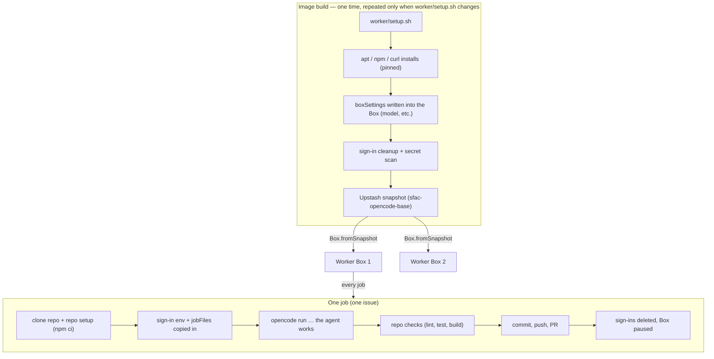
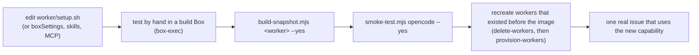

# The worker environment, the image, and the agent harness

Everything about what runs inside a worker Box, how it gets there, and how to
extend it: the model, skills, instructions (`AGENTS.md`), MCP servers, custom
agents, system packages, and the rules of the harness that actually executes
an issue.

## 1. Three layers, three lifetimes



| Layer | Lifetime | Where it is defined | What belongs there |
|---|---|---|---|
| **Worker image** (snapshot) | Until you rebuild it | `worker/setup.sh` + the agent's `boxSettings` | Slow, rarely-changing tools: the agent CLI, skills, MCP servers and their packages, browser tooling, language toolchains |
| **Box** | The worker's life (paused between jobs) | Created from the snapshot; `factory.browser` decided at creation | Nothing that must be fresh per job. The disk persists, so anything left behind persists |
| **Job** | One issue, minutes | `factory.config.json` + the repo itself | Sign-ins (deleted in `finally`), `jobFiles`, the repo clone, the prompt, the checks |

The image is built by `scripts/build-snapshot.mjs <worker id>` inside one
worker's Box: it resumes the Box, runs `worker/setup.sh`, writes the agent
type's `boxSettings`, deletes known secret paths, scans the disk for
secret-looking text, takes a snapshot, and records its id as
`agents.<name>.snapshotId` in `factory.config.json`. New Boxes are created
with `Box.fromSnapshot`; that is the whole mechanism.

**Browser access is not in `setup.sh`.** It is a property of the Box, set when
the Box is created (`factory.browser`), and an image can only pass it on if it
was built in a browser-enabled Box. See `docs/guide.md` §8.

## 2. What is in this factory's image today

- **OpenCode CLI v2.0.31**, pinned, at `~/.opencode/bin/opencode` — installed
  by `https://opencode.ai/v2/install`, symlinked into `/usr/local/bin`, and
  prepended to `PATH` for login shells via `/etc/profile.d/opencode.sh`.
- `OPENCODE_DISABLE_AUTOUPDATE=1` is exported for the agent run, and
  `"update": "disable"` is written into the Box settings; the binary stays
  what was tested.
- The stock Box underneath contributes: Debian 12 (ARM64), Node 25.9, npm,
  pnpm, yarn, bun, git, make, gcc, Python 3.11 (no pip).
- Model settings baked in: `/home/boxuser/.config/opencode/opencode.json` →
  `{"model": "opencode-go/deepseek-v4.1-flash", "update": "disable"}`.

Inspect any Box yourself:

```bash
node --env-file=.env scripts/box-exec.mjs sfac-opencode-01 'bash -lc "opencode --version; ls ~/.config/opencode"'
```

> A Box also ships the platform's **own** OpenCode v1 at `/opt/runner/bin`.
> Plain `sh` finds that one first; login shells — where every factory command
> runs — find our pinned v2. Nothing in the factory needs the platform's v1,
> and it is left alone.

## 3. The harness: what actually executes the issue

The agent type's `command` in `factory.config.json` is the whole harness
invocation:

```text
opencode run --standalone --auto "$(cat {prompt})" > {summary}
```

- `run` — headless mode. stdout carries exactly the final reply (progress goes
  to stderr), which is why `> {summary}` is enough to give the PR its
  description.
- `--standalone` — a private server for this one call, inheriting the job's
  environment (including the sign-in env file). No shared service state
  between jobs.
- `--auto` — auto-approves every permission that is not explicitly denied.
  Required: nobody can answer a prompt inside a Box. What is allowed can still
  be narrowed with `permissions` rules in the config (see §5e).
- The model comes from the Box's `opencode.json`, not from a flag, so
  different workers can run different models with the same command.
- The prompt file is the issue's title/body/comments plus the factory's rules
  (smallest change, no `git` actions, checks must pass, `NEEDS_CLARIFICATION:`
  to hand back). Repo `AGENTS.md` and global instructions are added by OpenCode
  itself; the factory's rules win where they overlap.

## 4. Configuring what the harness can use

### a. Model and reasoning effort — `boxSettings`

Lives in the Box (and in the image), written by the factory. To change:

```jsonc
"boxSettings": [
  { "path": "/home/boxuser/.config/opencode/opencode.json", "format": "json",
    "values": { "model": "opencode-go/deepseek-v4.1-flash", "update": "disable" } }
]
```

then `scripts/apply-box-settings.mjs --yes` for existing Boxes **and** rebuild
the image. JSON settings are *merged*, so adding keys never clobbers others.
For a second worker flavour (say a cheap and a deep pool), add another agent
type with the same `auth`/`command` and different `boxSettings`, give it its
own workers, and pick per issue with its `agent:<name>` label. Reasoning
effort is part of the model/variant selection (`provider/model#variant`).

### b. Skills

OpenCode discovers skills from these places, in increasing precedence:

| Scope | Directories |
|---|---|
| Global | `~/.config/opencode/skills` (in a Box: `/home/boxuser/.config/opencode/skills`) |
| Global compatibility | `~/.claude/skills`, `~/.agents/skills` |
| Project | `.opencode/skills`, plus compatibility `.claude/skills`, `.agents/skills` in the repo |

A skill is a directory with a `SKILL.md` (frontmatter `name` +
`description`; optional supporting files beside it), or a flat `<id>.md`.
The description is how the model decides to load it — no description, no
discovery. Extra sources (local dirs or HTTP catalogs) can be added with a
`skills: [...]` array in `opencode.json` — which `boxSettings` can write.

Two ways to make a skill available to every worker job:

1. **In the image** (every repo, pinned to a version): install into
   `~/.config/opencode/skills` in `worker/setup.sh`, e.g.
   `npx -y skills@latest add <owner>/<repo> --skill <name> --global --agent opencode --copy --yes`
   (verify the path it lands in once with `box-exec`), or simply `cp -r` the
   skill folder there. Pin: a skill that changes under you changes the agent's
   behaviour.
2. **Per job** (`jobFiles`): copy a `SKILL.md` from this repo into the Box at
   the start of every job — good while you are iterating on the wording. Note
   jobFiles land wherever you point them; for a discovery path that means
   `/home/boxuser/.config/opencode/skills/<id>/SKILL.md`.

### c. Rules: `AGENTS.md` and friends

OpenCode V2 reads **`AGENTS.md`** only (no `CLAUDE.md` fallback), combining,
in this order: the global file `~/.config/opencode/AGENTS.md`, then project
files from the workspace up to the project root. **The taskboard repo has its
own `AGENTS.md`** — the agent reads it automatically from the checkout; that is
the right home for repo-wide conventions ("run the three commands", "domain
logic in `src/lib` with tests").

- **Global house rules** (every repo, every job): keep the text in this repo
  (`worker/AGENTS.md`) and list it under the agent's `jobFiles` with
  `"to": "/home/boxuser/.config/opencode/AGENTS.md"`. Edits apply from the
  next job — no image rebuild.
- **Baked-in rules** (rarely change, no per-job copy): put the file in the
  image. Rebuilding is needed for every edit, which is why jobFiles is the
  better default for rules you tune.
- Extra files or globs: the `instructions` array in `opencode.json` (also
  writable through `boxSettings`).
- **Precedence reality check:** sources are *combined*, not overridden. The
  factory's own prompt states its rules win over house rules; keep house rules
  compatible (above all: agents must not run git commands — the factory does).

### d. MCP servers

Configured under `mcp.servers` in `opencode.json` — either
`{"type": "local", "command": [...], "environment": {"KEY": "{env:KEY}"}}` or
`{"type": "remote", "url": ..., "headers": {"Authorization": "Bearer {env:TOKEN}"}, "oauth": false}`.
`{env:NAME}` substitutes from the environment, so secrets stay out of the file.

In a headless Box, **OAuth-based MCP servers cannot complete sign-in** (there
is no human with a browser). Use API-key servers (`oauth: false` + headers),
or local servers. The pattern for a keyed server:

1. `worker/setup.sh` installs the server's package (it must exist in the
   image; remember ARM64).
2. `boxSettings` merges the `mcp.servers` entry into the global
   `opencode.json`, using `{env:MCP_API_KEY}`.
3. The agent type's `auth` in `factory.config.json` carries
   `{"secret": "MCP_API_KEY", "env": "MCP_API_KEY"}` — the key is placed in
   the Box for one job and deleted with it.

Check connections inside a Box with `bash -lc "opencode mcp list"`. MCP tools
appear to the model under Code Mode and can be filtered with permission
actions named `<server>_<tool>` (§5e).

### e. Permissions, agents, and subagents

- **Permissions** are ordered rules (`action`/`resource`/`effect`), with the
  last match winning; a `deny` is always enforced, even under `--auto`. To
  switch off a capability for every worker (say, web fetches during a
  refactor), add rules through `boxSettings`. This is also how to keep the
  default `.env` "ask" from being auto-approved: replace it with a `deny`.
- **Custom agents** (`~/.config/opencode/agents/<name>.md` in the image, or
  `.opencode/agents/` in a repo) can set a system prompt, model, permissions
  and `steps` for a named profile, and *subagents* (e.g. a read-only reviewer)
  that the main agent may launch. The factory does not need them to work, but
  they are the clean way to give the worker a specialised second opinion
  (a `reviewer` subagent whose `edit` permissions are denied) — put them in
  the image, or ship them as `jobFiles` while tuning. The default agent is
  `build`; change with `default_agent`.

### f. System packages and toolchains

`sudo` works (passwordless) in `setup.sh`; the Box is **ARM64 Debian 12** —
check that anything you install ships for ARM64 (for example: Debian's
`chromium`, not Chrome-for-Testing). Environment variables needed at run time
(by the agent, the repo setup, or the checks — all run as login shells) belong
in `/etc/profile.d/<name>.sh`. For browser-capable workers, the Box's own
Chromium listens on port 9222 once the factory opens a tab; a browser tool
like `agent-browser` should attach to it (`AGENT_BROWSER_AUTO_CONNECT=1` when
the port answers), with Debian's `chromium` as fallback. See the commented
recipes in `worker/setup.sh`.

## 5. The lifecycle of a change (and what to test)



- **In the image**: secrets, app code, anything you will keep editing. The
  build deletes known sign-in paths and greps the disk before snapshotting;
  add your own patterns via `factory.secretScanPatterns` when a new tool keeps
  credentials somewhere unusual.
- **Test before snapshotting**: run `scripts/box-exec.mjs <box> "<command>"` in
  the build Box and prove the tool works (versions, `opencode mcp list`, a
  real action).
- **After the change**: rebuild the snapshot, run the smoke test (it starts
  from the image, so it proves the image), then recreate any workers that
  predate the image — a Box keeps its old disk until it is deleted. Old
  snapshots are deleted in the Upstash console once no Box needs them.
- **First job on the new image**: one small issue that *uses* the new
  capability, and read the PR — that is the only proof the agent can actually
  drive it.

## 6. Cheat sheet

| Want to change… | Edit | Then |
|---|---|---|
| Model / effort | `agents.opencode.boxSettings` | `apply-box-settings.mjs --yes` + rebuild image |
| A skill for all jobs | `worker/setup.sh` (install into `~/.config/opencode/skills`) | rebuild image |
| A rule text tuned often | `worker/AGENTS.md` + `jobFiles` entry | nothing (next job picks it up) |
| Repo conventions | the app repo's own `AGENTS.md` | nothing (in the clone) |
| An MCP server | `worker/setup.sh` + `boxSettings` `mcp.servers` + `auth` entry for the key | rebuild image; `set-secrets.mjs --yes` |
| A reviewer subagent | `worker/setup.sh` writes `~/.config/opencode/agents/reviewer.md` | rebuild image |
| Tighten permissions | `boxSettings` `permissions` rules | rebuild image + `apply-box-settings.mjs --yes` |
| Add a system tool | `worker/setup.sh` (`apt`, pinned) | rebuild image, smoke test |
